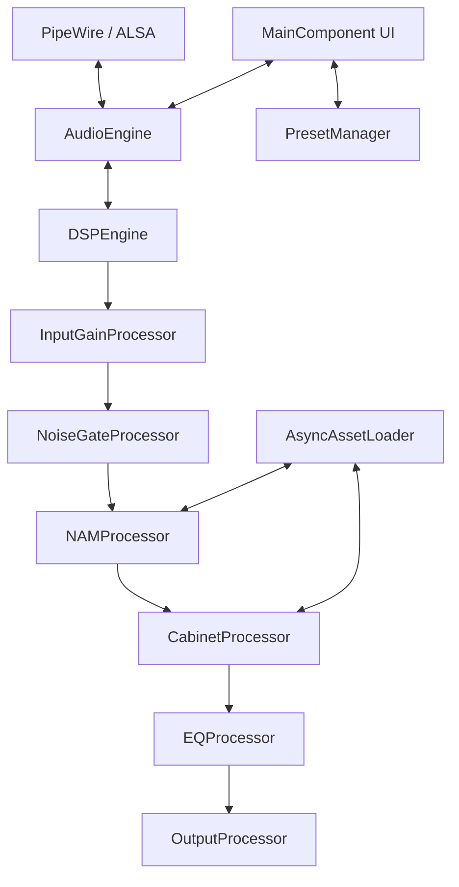

# GuitarFX

A minimal real-time guitar effects application for Linux. 

## Tech Stack
* **Language/Standard**: C++23 (compiled with strict warning flags and ASan/UBSan targets)
* **Libraries**: JUCE 8 (Audio Device Management, UI), NeuralAmpModelerCore (AI-powered amp simulation), Eigen (Math kernels), nlohmann_json (Preset serialization)
* **Build System**: CMake + Ninja

---

## Architectural Layout

The application isolates the real-time DSP logic from the desktop application layers to ensure safety, performance, and future expandability (e.g. wrapper into a VST3/LV2 plugin).



1. **`guitarfx-core` (DSP Engine)**: Real-time safe signal processors. Disables denormals using SSE control registers, utilizes linear/exponential parameter smoothing to avoid clicks, and encapsulates the effect chain.
2. **`guitarfx-app` (Desktop App)**: GUI standalone client built using JUCE 8, featuring backend configuration (JACK/ALSA), real-time peak/RMS VU meters, dynamic chain reordering via Up/Down buttons, file loaders for NAM models and Cabinet IRs, and preset import/export.
3. **`guitarfx-tests` (Unit Test Suite)**: Automated verification of parameter smoothing, bypass transitions, preset serialization, silence propagation, NaN/Inf robustness, and determinism.
4. **`guitarfx-benchmark` (Headless Benchmark)**: Measures processing duration against low-latency block deadlines to audit real-time CPU consumption.

---

## Real-Time Thread Constraints & Optimizations

To avoid audio dropouts (xruns), the real-time audio callback is strictly allocation-free, lock-free, and I/O-free:
* **Background Asset Loading**: Model files (`.nam`) and Cabinet IRs (`.wav`) are read and resampled on a worker thread (`AsyncAssetLoader`). Once loaded, they are swapped into the active processor using atomic pointers.
* **Lock-Free Garbage Collection**: Decommissioned models and IR coefficient vectors are passed to a lock-free Single-Producer Single-Consumer queue (`LockFreePointerQueue`). The loader thread periodically cleans this queue outside of the audio thread.
* **Direct Convolution**: The circular history buffer in `CabinetProcessor` uses a flat layout of size `2 * MAX_IR_SIZE` where the write index wraps at `MAX_IR_SIZE` and writes are duplicated at `+MAX_IR_SIZE`. This enables a contiguous, vectorizable loop for convolution and makes crossfades real-time safe without any object allocations or deallocations.
* **Brickwall Output Limiter**: A zero-latency safety limiter is integrated into the final output stage to protect hearing and speakers.

---

## Build Instructions

### Prerequisites
Ensure your Linux system has `cmake`, `ninja`, and basic build essentials installed, as well as libraries for ALSA, JACK, and GL.
```bash
sudo apt install build-essential cmake ninja-build libasound2-dev libjack-jackd2-dev libfreetype6-dev libx11-dev libxext-dev libxinerama-dev libxrandr-dev libxcursor-dev libcurl4-openssl-dev
```

### Compile
```bash
cmake -B build -DCMAKE_BUILD_TYPE=Release -G Ninja
cmake --build build --parallel 8
```

---

## Running the Targets

### 1. Run Unit Tests
```bash
./build/guitarfx-tests
```

### 2. Run Headless Benchmark
```bash
./build/guitarfx-benchmark
```

### 3. Launch Standalone GUI App
```bash
./build/guitarfx-app_artefacts/Release/GuitarFX
```
